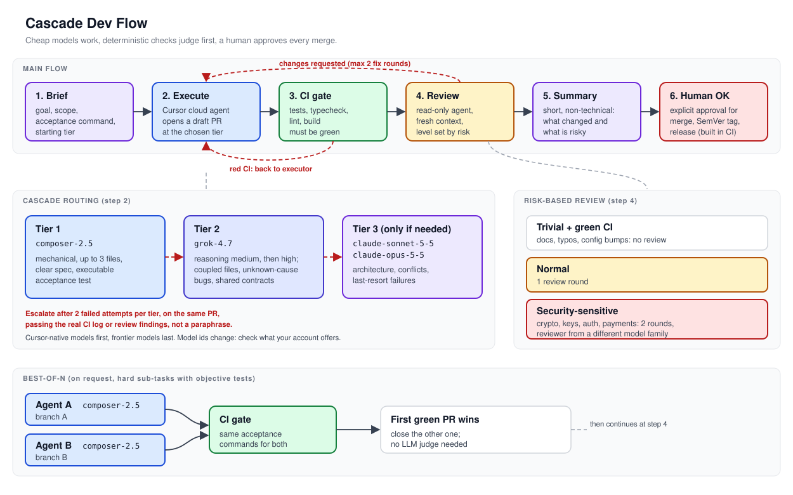

# Cascade Dev Flow

A lightweight workflow for shipping code with AI coding agents in Cursor. A lead agent plans, cheap models do the work, deterministic checks come before any LLM judgment, and a human approves every merge.

Inspired by [cryptosecco/octopus](https://github.com/cryptosecco/octopus) (a Claude Code command), adapted for Cursor cloud agents and Cursor-first model routing.



## Roles

| Role | Who | Does |
|---|---|---|
| Lead | a planning agent (or you) | writes the brief, picks the starting tier, escalates, summarizes for the human |
| Executor | a Cursor cloud agent | implements the brief on a branch and opens a draft PR |
| Reviewer | a separate read-only agent | reviews the diff with fresh context, never pushes |
| Human | you | approves merge, tag and release |

## Flow

1. **Brief.** Goal, files in scope, acceptance criteria, the exact command that proves it works.
2. **Execute.** Launch a cloud agent at the starting tier. It opens a draft PR.
3. **CI gate.** Tests, typecheck, lint and build must be green. Red CI goes back to the executor; the reviewer never sees it.
4. **Risk-based review.** See the table below.
5. **Summary.** The lead writes a short, non-technical summary of what changed and what is risky.
6. **Human OK.** Merge, SemVer tag and release only after explicit approval. Builds run in CI.

## Cascade routing

Start at the cheapest tier that can plausibly succeed. Move up only on evidence of failure.

| Tier | Model (Cursor ids) | Use when |
|---|---|---|
| 1 | `composer-2.5` | mechanical change, up to 3 files, unambiguous spec, executable acceptance test |
| 2 | `grok-4.7` (reasoning medium, then high) | several coupled files, bug with unknown cause, shared contracts, or tier 1 failed twice |
| 3 | `claude-sonnet-5-5`, then `claude-opus-5-5` (effort high) | only if tier 2 is not enough: architecture decisions, conflicts between sub-tasks, last-resort failures |

Rules:
- At most 2 attempts per tier.
- Escalate on the same PR (follow-up to the same agent with a new model), passing the real CI or review error, not a paraphrase.
- Model ids change over time. Check the list your Cursor account offers and keep the order: Cursor-native and fast models first, frontier models last.

## Risk-based review

| Change | Review |
|---|---|
| Trivial (docs, typos, config bumps) with green CI | none |
| Normal | 1 round |
| Security-sensitive (crypto, keys, auth, payments) | 2 rounds, reviewer model from a different family than the executor |

The reviewer is read-only and gets at most 2 fix rounds per PR. If it is still not right after that, the lead escalates the tier or brings it to the human.

## Best-of-N (on request only)

For hard sub-tasks with objective tests: run 2 tier-1 agents in parallel on separate branches. The first one that passes CI wins; close the other PR. No LLM judge needed.

## Files

```
README.md                          this overview
docs/workflow.svg                  diagram of the flow
docs/routing.md                    how to pick and escalate tiers, with examples
templates/brief.md                 brief template for the executor
templates/review.md                reviewer prompt and checklist
.cursor/rules/cascade-flow.mdc     drop-in Cursor rule for a lead agent
```

## License

MIT
